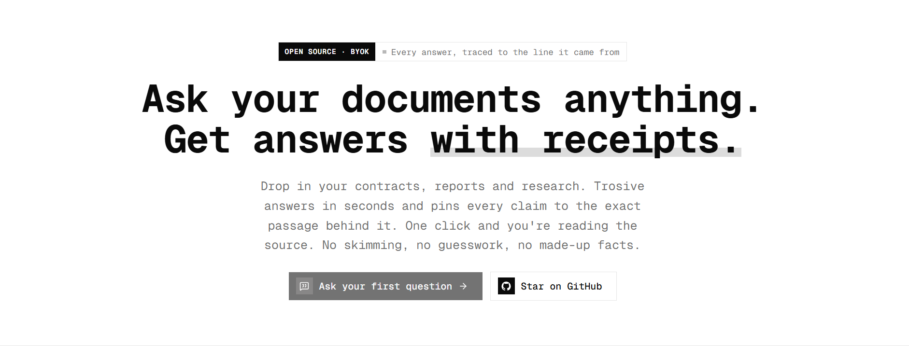

<picture>
  <source media="(prefers-color-scheme: dark)" srcset="public/brand/trosive-mark-dark.svg">
  
</picture>

# Trosive

Ask questions across your documents and get answers that cite the exact passage
they came from. When the documents don't support an answer, Trosive says so
instead of guessing.

Trosive is free and open source, with no plans and no usage limits. It's
**bring your own key**: every workspace adds its own Anthropic API key, and
answers are billed by Anthropic to that key.

**Website:** [trosive.com](https://trosive.com) · **Contact:** [hello@trosive.com](mailto:hello@trosive.com)

[](https://github.com/andrebuilds/trosive/actions/workflows/ci.yml)
[](LICENSE)
[](https://github.com/sponsors/andrebuilds)



## Features

- **Document library** — upload PDF, Word (`.docx`), text and markdown files
  into a shared workspace.
- **Cited chat** — streaming answers from Claude where every claim links to the
  passage it is based on, with a source reader that highlights the quote.
- **Passage search** — search across the whole library or a subset of it.
- **Workspaces** — create as many as you like and switch between them from
  the sidebar. Invite teammates by email as admins or members; everyone in a
  workspace shares its library, chats and API key. Members delete only what
  they made, owners and admins anything.
- **Admin console** — usage overview, users (add, deactivate, reactivate), an
  append-only activity log, sign-up and maintenance switches, and chat
  retention.
- **Bring your own key** — each workspace saves its own Anthropic API key,
  checked with Anthropic before it's stored and encrypted at rest. No plans,
  no limits, nothing to bill.

## Tech stack

Next.js 16 · React 19 · Tailwind v4 · shadcn/ui · Better Auth · Prisma 7 ·
Neon Postgres · Anthropic API · Resend

## Getting started

Requirements: Node.js 22+ and a [Neon](https://neon.tech) Postgres database (the
free plan is enough). The app connects through Neon's serverless driver, so a
plain Postgres server won't work without changing `lib/db.ts`.

```bash
git clone https://github.com/andrebuilds/trosive.git
cd trosive
npm install
cp .env.example .env   # then fill in the values below
npm run db:migrate     # creates the tables
npm run dev
```

Open <http://localhost:3000>.

## Environment

`.env` is read by both Next.js and the Prisma CLI. Every variable is documented
in [`.env.example`](.env.example); the essentials are below.

### Database (required)

Create a project at [neon.tech](https://neon.tech) and run `neon env pull`, or
copy both connection strings from the dashboard:

- `DATABASE_URL` — the **pooled** string (host contains `-pooler`). Used by the
  app at runtime.
- `DATABASE_URL_UNPOOLED` — the same string without `-pooler`. Used by
  migrations, because pgBouncer can't run DDL inside a transaction. `DIRECT_URL`
  is accepted as an alias.

### Auth (required)

- `BETTER_AUTH_SECRET` — generate with `openssl rand -base64 32`.
- `BETTER_AUTH_URL` / `NEXT_PUBLIC_APP_URL` — `http://localhost:3000` locally,
  your domain in production. `NEXT_PUBLIC_APP_URL` is also the address used in
  the sitemap, robots.txt and link previews, so set it before you deploy.

### Anthropic API keys (bring your own key)

Nothing to set up on the server. After naming their workspace, the owner is
asked for an Anthropic API key (they can skip it and add it later in
**Settings → API key**). Owners and admins can replace or remove it there; other
members see only whether it works.

- The key is checked with Anthropic (`models.list`, which costs nothing) before
  it's saved.
- It's stored encrypted with AES-256-GCM, under a key derived from
  `BETTER_AUTH_SECRET`. It's never sent back to the browser or logged; the UI
  only ever shows a hint like `sk-ant-api03-…AbCd`.
- If Anthropic later rejects it (revoked, out of credit), it's marked as not
  working, the app says so, and the workspace's owners get an email.

**Rotating `BETTER_AUTH_SECRET` makes every saved key unreadable.** Workspaces
are then asked to enter their key again.

`ANTHROPIC_API_KEY` is optional. When set, it answers for every workspace that
hasn't saved a key of its own, which is handy for a private self-hosted
instance. Leave it empty on a public one, or you pay for everybody.

### Email (optional, recommended)

Without `RESEND_API_KEY`, sign-in links and other emails are printed to the
terminal instead of sent, which is enough to test the flows locally. To send for
real, add a [Resend](https://resend.com) key and set `EMAIL_FROM` to an address
on a domain you've verified there.

Invitations are emailed to the invited address and work for seven days. When
someone accepts, two emails go out at once: one tells whoever invited them, the
other confirms to the new member that they're in. An invited address can sign
up even while sign-ups are closed in the admin console.

### Social sign-in (optional)

Google and GitHub buttons appear in the auth dialogs only when both env vars for
that provider are set, so you can skip this entirely.

| Provider | Console                                                            | Redirect URI                                     |
| -------- | ------------------------------------------------------------------ | ------------------------------------------------ |
| Google   | [Cloud console](https://console.cloud.google.com/apis/credentials) | `http://localhost:3000/api/auth/callback/google` |
| GitHub   | [Developer settings](https://github.com/settings/developers)       | `http://localhost:3000/api/auth/callback/github` |

Swap `localhost:3000` for your domain in production.

### Admin console

Set `ADMIN_USER_IDS` to your user id (comma-separated for more than one) to
open `/app/admin` to you. There's no "make admin" button in the console yet, so
keep your id in the list: to add another admin, add their id too, or set
`role = 'admin'` on their row in the `user` table.

### Data retention

The retention window is set in the admin console. A scheduler purges expired
chats by calling `POST /api/cron/retention` with
`Authorization: Bearer $CRON_SECRET`. Once a day is enough, for example:

```bash
curl -X POST https://your-domain.com/api/cron/retention \
  -H "Authorization: Bearer $CRON_SECRET"
```

Run it from a Railway cron service, a scheduled GitHub Actions workflow or any
other scheduler.

## Scripts

| Script                  | What it does                                         |
| ----------------------- | ---------------------------------------------------- |
| `npm run dev`           | Dev server                                           |
| `npm run build`         | Production build                                     |
| `npm run lint`          | ESLint                                               |
| `npm run typecheck`     | `tsc --noEmit`                                       |
| `npm run format`        | Prettier                                             |
| `npm run auth:generate` | Regenerate the auth models in `prisma/schema.prisma` |
| `npm run db:migrate`    | Create and apply a migration                         |
| `npm run db:deploy`     | Apply pending migrations (production)                |
| `npm run db:studio`     | Browse the database                                  |

Re-run `auth:generate` then `db:migrate` after changing auth options or plugins
in `lib/auth.ts`.

## Deploying

The repo ships a [`railway.json`](railway.json) that runs migrations before each
deploy, but any Node host works: run `npm run db:deploy`, `npm run build`, then
`npm run start`.

If you run a modified version as a public service, the AGPL requires you to
offer your users its source. Point `repoUrl` in
[`lib/site-config.ts`](lib/site-config.ts) at your fork — it's linked from the
site footer.

Running your own public instance? Also change the name, contact emails and
author in `lib/site-config.ts`, and replace the Privacy, Terms and Cookies
pages in `app/(marketing)/`: they describe trosive.com and the person who runs
it, not you.

## Contributing

Contributions are welcome — see [CONTRIBUTING.md](CONTRIBUTING.md). Please
report security issues privately as described in [SECURITY.md](SECURITY.md).

## License

[AGPL-3.0](LICENSE) © [Andrea D'Ambrosio](https://github.com/andrebuilds)
